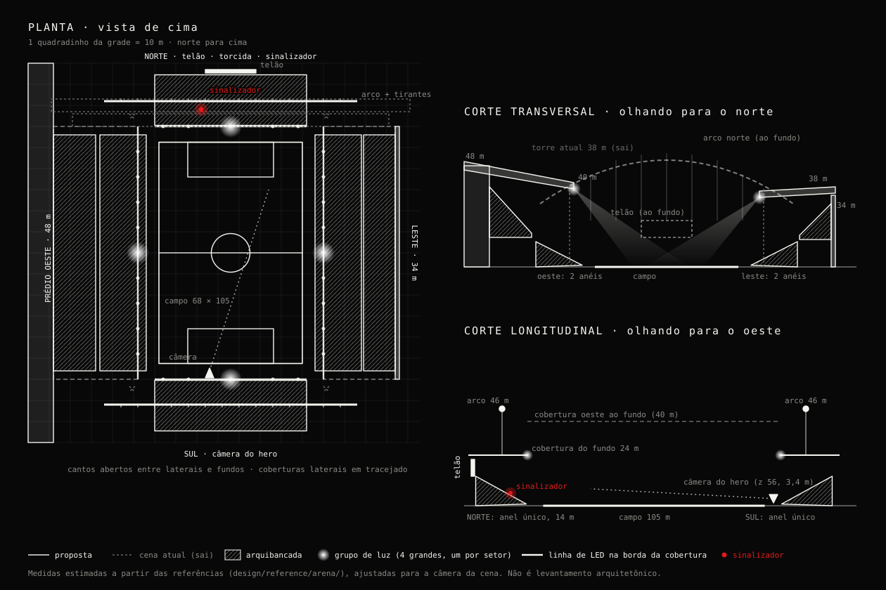

# Estádio inspirado na arena de Itaquera (plano para o futuro)

> O [plano Awwwards](plano-awwwards.md) prevalece onde divergir: a estrutura ganha luz assada por um script no navegador ([desenho](bake-luz.md); o [Blender](arena-blender.md) ficou como alternativa), e a câmera vira plano-sequência.

Status: **fases 1 e 2 entregues em out/2026** (referências, esboço e estrutura com luz e torcida, inclusive no pênalti). Próximas: telão dinâmico e o 2D. Este documento registra a direção combinada para quando o estádio do site for trocado por um inspirado na arquitetura da arena do Corinthians (Neo Química Arena).

## 1. Quem faz o quê

O estádio do hero **não é uma imagem**: é uma cena 3D gerada por código (`src/components/scene/stadium/`, three.js + shaders). As arquibancadas, os refletores, a neblina e o gramado são geometria e shader. Nenhuma imagem do Nano Banana entra nessa cena.

| Parte | Quem faz | Por quê |
|---|---|---|
| Cena 3D do hero (arquibancadas, cobertura, iluminação, telão) | **Claude, em código** | É geometria procedural; uma imagem não substitui nem melhora isso |
| Estádio do pênalti (`PenaltyScene.tsx`) | **Claude, em código** | Mesmo motivo; precisa casar com o hero |
| Fallback estático (`StaticStadium`, sem WebGL) | **Claude, em CSS/SVG** | Hoje é só CSS, sem imagem; continua leve |
| Concept art para definir o visual antes de codar | **Você, no Nano Banana** | Serve só de referência; não é publicada |
| Key arts das súmulas (CONECTA, Sentinela, Gustavo OS) e a OG image, se quiser que todas "aconteçam" na arena | **Você, no Nano Banana** (prompts no §6) | São imagens 2D; eu ajusto corte, grão e contraste antes de publicar |
| Fotos de referência da arena | **Você** | 4–6 fotos em `design/reference/arena/`, só para eu ver proporções. **Não vão para `public/`** (direito autoral de terceiros) |

Resumo: o trabalho pesado é meu; do seu lado, fotos de referência e (opcional) as imagens 2D do Nano Banana.

## 2. Regras de marca

- Inspirado **na arquitetura**, nunca na marca: sem o nome "Neo Química Arena" (é naming rights de patrocinador), sem escudo do Corinthians, sem logo de patrocinador ou de fornecedor e sem texto de marca no telão.
- Nos textos do site, se precisar citar: "a arena de Itaquera" ou "a casa". De preferência, não citar: quem conhece reconhece pela silhueta.
- A paleta não muda: preto e branco com o vermelho de sinalizador, e o âmbar no Modo Resenha. O alvinegro já combina.

## 3. Referências e o que elas confirmam

Arquivos em `design/reference/arena/` (fora do `public/`, nunca publicados):

| Arquivo | O que é | Pode publicar? |
|---|---|---|
| `concept-aerea-noite.webp` | Concept no estilo do site: vista aérea à noite, prédio alto num lado, cobertura em curva, neblina, sinalizador vermelho, traços de giz e espaço vazio à esquerda | Sim, se foi gerada por você (sem marca visível). Candidata a OG image ou à chegada à arena (fase 5) |
| `concept-interior-prancheta.webp` | Concept no estilo do site: interior visto do campo, arquibancada atrás do gol com o telão em cima, luzes na borda da cobertura, jogadas em giz no gramado, sinalizador vermelho no canto | Sim, mesma ressalva. Candidata a OG image e ao fallback estático |
| `torcida-sinalizadores-cobertura.webp` | Torcida atrás do gol com bandeiras, sinalizadores e fumaça, cobertura com luzes | **Não**: tem escudos e marca de patrocinador. Só referência de clima e de luz |
| `interior-cobertura-telao.png` | Foto real à noite: linhas do campo acesas, arco da cobertura sobre o fundo, telão sobre a arquibancada atrás do gol | **Não** (foto de terceiros). Só referência de proporção |
| `festa-fogos-sinalizadores.png` | Fogos e sinalizadores vermelhos atrás do gol | **Não** (foto de terceiros). Referência para o apito final |

O que as referências mostram e muda o plano:

1. **Laterais altas e cobertas, fundos baixos.** As arquibancadas laterais são altas e ficam sob a cobertura principal. O lado do prédio é um bloco maciço, alto e retangular, com fachada em painéis verticais. Atrás dos gols, a arquibancada tem um anel só e é bem mais baixa.
2. **Cobertura em dois níveis.** Os lados longos têm a cobertura pesada, com treliça aparente e painéis translúcidos. Sobre os fundos passa um **arco metálico claro**, com tirantes verticais segurando uma cobertura fina. Esse arco é a assinatura que mais aparece nas fotos e deve ser a primeira coisa a ficar certa na cena.
3. **Luz em dois tipos, os dois na borda da cobertura:** grupos de refletores espaçados ao longo da borda, como "lâmpadas penduradas", e uma linha contínua de LED contornando a borda interna. Nenhuma torre. Os grupos espaçados dão para manter o motivo dos "4" com quatro grupos maiores, um por setor.
4. **Telão sobre a arquibancada atrás do gol**, centralizado. É o lugar natural para o placar dos pênaltis e para o "Bora pra resenha?".
5. **Cantos abertos** entre as laterais e os fundos: a neblina e a luz vazam por ali, o que ajuda no recorte da silhueta.
6. **Linhas do campo acesas** na foto noturna: o shader do gramado já desenha as linhas e pode ganhar brilho próprio quando os refletores apagam no apito final.
7. **Clima atrás do gol:** sinalizadores vermelhos, fumaça e bandeiras (sem escudo). Os fogos da foto da festa encaixam no apito final como recompensa.

## 4. Impacto no que já existe

| Hoje | Na arena |
|---|---|
| 4 torres de refletor nos cantos (`FLOODLIGHTS`, `Towers`, `Glows`, `Beams` em `stadium/`) | Luz saindo da borda da cobertura: muitos feixes finos (instanciados) formando uma cortina de luz na neblina. As torres somem. |
| Preloader "refletor 1/4 … ok" e apito final com "os refletores apagam um a um" | Manter o "4" como **os quatro setores da cobertura** (norte, sul, leste, oeste): `> setor leste ........ ok`. O apito final apaga setor por setor. Ajustar `copy.boot` (PT/EN) e `docs/art-direction.md` §4. |
| 4 caixas inclinadas como arquibancadas (`Stands`) | Perfil em degraus por setor (`ExtrudeGeometry` a partir de uma seção transversal 2D), com o oeste mais alto que os outros. |
| Sem cobertura | Novo `Roof`: treliças finas (`InstancedMesh` ou `LineSegments`) e uma placa semitransparente que recorta a neblina. |
| Sem cobertura sobre os fundos | Arco metálico claro com tirantes verticais sobre a arquibancada baixa atrás de cada gol (§3, item 2). |
| Sem telão | Telão sobre a arquibancada atrás do gol, com shader de "pixels" mostrando conteúdo do site: número do capítulo, placar da disputa de pênaltis e "Bora pra resenha?" no Modo Resenha. |
| Sinalizador na arquibancada do fundo (`FLARE`) | Continua atrás do gol, no meio da torcida, agora numa arquibancada baixa sob o telão. No apito final, fogos curtos sobre o fundo (partículas, só nos tiers `mid` e `high`). |
| `CHAPTER_PRESETS` (enquadramentos por capítulo) | Revisar: a vista tática de cima vai bater na cobertura, então ela precisa de uma abertura central ou a câmera fica abaixo da borda. |
| Fallback em CSS | Silhueta da cobertura em SVG + cortina de luz em gradiente. Continua sem imagem. |
| Estádio do pênalti | Mesma silhueta e mesma luz de borda ao fundo. |

**Limites de performance:** não piorar o TBT da home no mobile (hoje 1,7 s, ver README). Geometria instanciada, sem texturas grandes. No tier `low`, só a silhueta da cobertura, sem treliças.

**Testes:** os do projeto `webgl` (`e2e/scene.spec.ts`) e a auditoria axe precisam continuar passando.

## 5. Fases sugeridas

1. **Referência:** ✅ fotos e duas concept arts em `design/reference/arena/`, analisadas no §3. Esboço de proporções entregue no §7, aguardando sua aprovação antes de mexer na cena.
2. **Estrutura:** ✅ laterais iguais (leste = oeste, decisão do Gustavo ao aprovar o esboço), fundos baixos com arco e tirantes, cobertura com treliça e linha de LED, 12 grupos de luz no lugar das torres, preloader e apito final em setores. Junto: a torcida norte com bandeirões, bandeiras de mastro e 6 sinalizadores, também atrás do gol no pênalti.
3. **Telão:** conteúdo dinâmico (capítulo, placar dos pênaltis, Modo Resenha).
4. **2D:** key arts e OG image novas (se quiser) e o fallback estático. (O estádio do pênalti já ganhou a torcida norte na fase 2.)
5. **Opcional:** o preloader vira a chegada à arena, com a câmera de fora vendo a fachada de LED acender e entrando pelo túnel. É a fase mais cara; só vale se as outras ficarem leves.

## 6. Prompts para o Nano Banana

Use o **estilo comum** do apêndice de `docs/art-direction.md` no início de cada prompt e, depois dele, o trecho abaixo. Sempre peça 2–3 variações.

**A. Concept da arena (só referência, não publicada):**
> …a modern football arena at night inspired by São Paulo's east-zone stadium architecture: asymmetric stands, the west side a tall building with a glass curtain wall, a long steel-truss roof with exposed structure cutting a sharp silhouette against dense fog, a continuous line of lights along the roof edge casting a curtain of thin beams onto the pitch instead of corner floodlight towers, steep stands close to the pitch, one red flare glowing in the stand behind the goal. Wide establishing shot from the pitch corner, low angle.

**B. OG image na arena (1200 × 630):**
> …the same arena seen from the tunnel exit at pitch level, the roof-edge light line and its curtain of beams cutting the fog, one red flare in the stand behind the goal, a diagonal black-and-white band crossing the frame, large empty space on the left half for the name to be added later in code. 1200×630.

**C. Fundo para as key arts das súmulas** (acrescente ao fim de cada prompt já existente no apêndice):
> …set inside the same arena: the steel-truss roof silhouette and its line of edge lights visible in the background through the fog.

Ao mandar as imagens, coloque os originais em `design/key-art/<slug>/` (como já é feito). Eu escolho, ajusto grão, contraste e corte e publico em `public/images/<slug>/cover.jpg`.

## 7. Esboço de proporções (aguardando aprovação)

Medidas estimadas a partir das referências e ajustadas para a câmera da cena; não é levantamento arquitetônico. O sistema é o mesmo de `stadium/config.ts`: metros, campo de 68 × 105 centrado na origem, **norte = −z** (o fundo que a câmera do hero vê) e **oeste = −x** (o lado do prédio).

| Elemento | Proposta | Hoje na cena |
|---|---|---|
| Recuo do campo | 6 m nas laterais, 8 m nos fundos | — |
| Lateral oeste | 2 anéis: inferior de 0,8 a 12 m (x −40 a −62), superior de 16 a 38 m (x −64 a −84); prédio maciço de 48 m atrás (x −84 a −96) | caixa inclinada em x = −48 |
| Lateral leste | **igual à oeste** (aprovado assim): 2 anéis até 38 m e bloco de 48 m atrás | caixa inclinada em x = 48 |
| Fundos (norte e sul) | anel único de 0,8 a 14 m, de z ±60,5 a ±84,5, largura 72 m; cantos abertos | duas caixas no norte (z −63 e −70), nada no sul |
| Coberturas laterais | treliça de ~4 m de altura; borda interna em x = ±44, a 40 m (oeste) e 36 m (leste) | — |
| Coberturas dos fundos | finas, a 24 m, de z ±60 a ±88, penduradas no arco | — |
| Arcos dos fundos | em z = ±72, de x −60 a 60, nascem a 30 m e chegam a 46 m no topo; tirantes a cada 8 m | — |
| Telão | atrás da arquibancada norte, centralizado: 24 × 8 m, de 14 a 22 m de altura | — |
| Luz | linha de LED em toda a borda interna das coberturas; 4 grupos grandes (oeste, leste, norte, sul) e grupos pequenos a cada ~12 m | 4 torres de 38 m nos cantos |
| Sinalizador | arquibancada norte, (−14, 6, −68) | (−20, 12,5, −61) |

**O que muda nas câmeras:**
- **Hero:** a câmera continua no sul, perto do gramado. O enquadramento passa a pegar a arquibancada baixa do norte, o telão e o arco, que é a vista mais reconhecível da arena (como na referência `interior-cobertura-telao.png`).
- **Abertura:** a câmera hoje "desce do refletor" em (40, 46, 66). Sem torres, ela passa a descer da borda da cobertura do sul. O ponto de partida fica igual, acima da cobertura do fundo sul e na frente do arco.
- **Vista tática:** a câmera fica a 66 m, acima da abertura da cobertura, que tem 88 × 120 m. Ela não bate em nada e a cobertura vira a moldura da prancheta.

**Para aprovar:**
1. Proporções gerais: o oeste bem mais alto, com o prédio, e fundos baixos com anel único.
2. O norte, o fundo que a câmera do hero vê, com o telão e o sinalizador.
3. Os 4 grupos grandes de luz representando os 4 setores, que substituem as 4 torres no preloader e no apito final.

